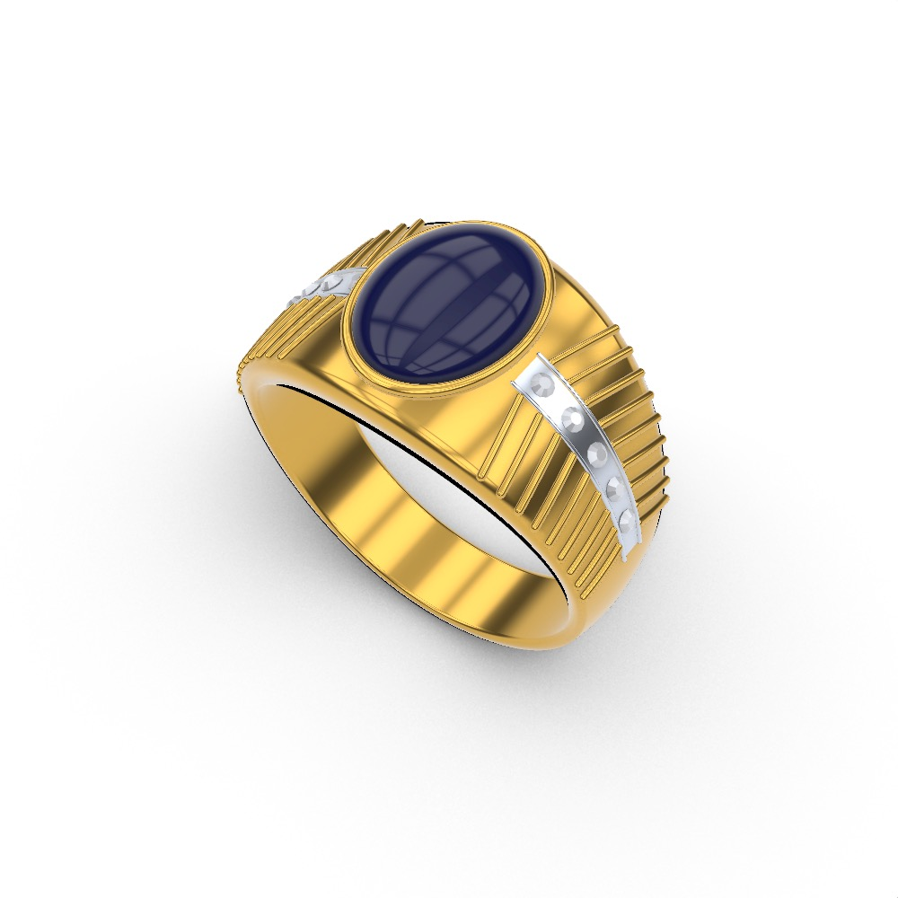

# Rhino Studio

[](https://github.com/AmadeusGB/rhino-studio/actions/workflows/ci.yml)
[](https://github.com/AmadeusGB/rhino-studio/releases)
[](LICENSE)

**Turn a reference image into an editable Rhino model.**

Rhino Studio is a local desktop companion for Rhino 8. Upload an image, describe the design and dimensions, and let a modeling agent build geometry in a separate Rhino document. Inspect four real viewport images and download the resulting **3DM** and **STL** files.

[中文说明](README.zh-CN.md) · [Installation](docs/INSTALLATION.md) · [Architecture](docs/ARCHITECTURE.md) · [Changelog](CHANGELOG.md)


*Example Rhino viewport from the project's jewelry modeling work. Output quality varies with the reference and the generated plan.*

## Features

- Image upload, drag-and-drop and paste; optional design notes and millimeter dimensions.
- C# RhinoCommon modeling plans executed through Rhino-MCP-Platform.
- Standard generation and debug mode with recorded stage screenshots.
- Perspective, top, front and right views of the actual model.
- Editable 3DM export and binary STL export with geometry validation.
- Jewelry body/assembly scope, thickness and selectable surface mesh settings.
- A persistent work library with search, rename, batch deletion and recovery.
- A serial job queue, diagnostic logs and automatic replanning after execution failures.

## Quick start

The supported desktop target is **macOS on Apple Silicon with Rhino 8**. The original integration was validated with Rhino 8.34 and Rhino-MCP-Platform 0.1.5. Other platforms and plugin versions are not release-validated.

You need Python 3.9+, Rhino 8, Rhino-MCP-Platform and an authenticated Codex CLI. The app has **no npm or pip runtime dependencies**. Image analysis uses the online service configured by Codex authentication and consumes account usage.

```sh
git clone https://github.com/AmadeusGB/rhino-studio.git
cd rhino-studio
# Start Rhino 8 first; run MCPConnect if the plugin is not connected.
cd web
python3 server.py
```

Open **http://localhost:8765**. Stop the foreground server with Ctrl-C. On macOS, double-click `web/start.command` to launch a background service and open the browser. Follow the [installation guide](docs/INSTALLATION.md) for plugin setup, configuration and troubleshooting.

## How it works

```text
Reference image + instructions
          ↓
Codex CLI → structured C# modeling plan
          ↓
Rhino MCP → separate desktop Rhino document
          ↓
Geometry checks → 3DM + STL + four viewport images
```

Jobs, input images, plans and results are stored under `web/data/<job-id>/`. Back up the complete `web/data/` directory, including `catalog.json`. Deleted work stays on disk and can be restored. A restarted service marks unfinished jobs as interrupted.

## Validation and limitations

Version **1.1.0** packages the C# execution engine and manufacturing export fixes. The local release check passes **29 automated tests** covering HTTP boundaries, job management, parameter validation, viewport handling and macOS Rhino process selection. These tests mock Rhino interactions; they do not prove arbitrary images can be modeled correctly. Earlier project records include real image-to-model runs; this publication does not claim a new full end-to-end Rhino acceptance run.

- A single image cannot establish hidden geometry, depth or precise dimensions. Generated assumptions need review.
- Valid, closed geometry is not a complete manufacturing certification. Check wall thickness, intersections, connections, tool access and machining setup before production.
- Surface mesh settings are Rhino meshing parameters, not measured whole-model error or CNC tolerance guarantees. Existing dense meshes retain their own precision.
- Reference gemstones remain in 3DM and are excluded from manufacturing STL. Unresolved unions or multiple volumes require review.
- STL has no unit metadata; import it as **millimeters**.
- Desktop Rhino may come to the foreground. The workflow is not headless.
- The health endpoint checks executable availability; it does not certify a live Rhino connection.

## Development

```sh
cd web
python3 -m unittest discover -s tests -v
```

An optional integration check requires a connected Rhino instance:

```sh
python3 tests/verify_manufacturing_rhino.py
```

It creates disposable headless documents inside the Rhino process for export checks. It does not turn the desktop generation workflow into a headless service.

See [CONTRIBUTING.md](CONTRIBUTING.md) and [SECURITY.md](SECURITY.md). The browser interface is currently in Chinese.

## License

Project source code is licensed under [MIT](LICENSE). Rhino, Rhino-MCP-Platform and Codex are separate dependencies governed by their own terms. This is an independent project, with no affiliation or endorsement implied.
